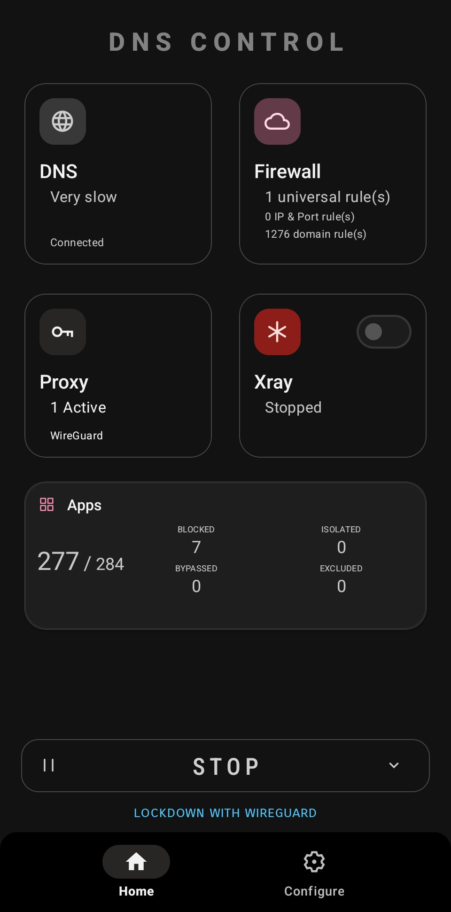

# DNS Control

A privacy-focused Android DNS and per-app firewall. DNS Control runs a local VPN
service that sends your DNS queries to the resolver you choose, and lets you decide
which apps can reach the network.

<p align="center">
  
</p>

## Features

- **Encrypted DNS**: DNS over HTTPS, DNS over TLS, Oblivious DNS over HTTPS (ODoH)
  and DNSCrypt, with custom resolvers and relays.
- **Plain DNS** on port 53, for resolvers without encryption.
- **Fail-closed**: if the encrypted resolver you picked fails, DNS does not quietly
  fall back to system DNS.
- **Presets**: Quad9 and Cloudflare to start with. Add your own anytime.
- **Blocklists**: optional on-device lists for ads, trackers, malware and phishing.
- **Per-app firewall**, plus custom domain and IP rules.
- **Proxies**: SOCKS5, HTTP, Orbot (Tor) and WireGuard. WireGuard configs can be
  imported from a file or pasted text.
- **Xray**: VLESS (REALITY or TLS), Trojan and Shadowsocks 2022. Xray runs on the
  device as a local SOCKS5 proxy.
- **Lockdown**: when on, DNS only goes through your WireGuard or SOCKS5 proxy.
- **TCP dial strategies**: optional split and desync options, with retry settings.
- **No logs, no Google**: connection and DNS logs are not stored or uploaded, and
  there is no Firebase or Google service in the app.
- **Manual updates**: the app checks GitHub only when you ask, and never installs
  anything on its own.

## Blocklists

Blocklists are optional. The app downloads a signed set built from public lists
(StevenBlack, HaGeZi, OISD and others), checks the signature, and then matches
queries on the device. Each upstream list keeps its own license. Sources and the
build pipeline are in the [rules-old README](https://github.com/hidefbi/rules-old#readme).

## DNSCrypt and ODoH servers

The app does not ship with DNSCrypt or ODoH servers or relays. Add them on the
DNSCrypt and ODoH screens, as `sdns://` stamps or `https://` URLs.

- DNSCrypt servers: https://github.com/Quad9DNS/dnscrypt-settings/blob/main/dnscrypt/quad9-resolvers.md
- DNSCrypt relays: https://github.com/DNSCrypt/dnscrypt-resolvers/blob/master/v3/relays.md
- ODoH targets: https://github.com/DNSCrypt/dnscrypt-resolvers/blob/master/v3/odoh-servers.md
- ODoH relays: https://github.com/DNSCrypt/dnscrypt-resolvers/blob/master/v3/odoh-relays.md

Without an ODoH relay, the target can see your IP address, and the app shows a warning.

## Requirements

- Android 6.0 (API 23) or later.
- Android Studio, or a JDK and the Android SDK.
- Go 1.26, for Xray-core.
- Network on the first build, for firestack (see below).

## Building

firestack is pulled from JitPack (`com.github.hidefbi:firestack`), so there is
nothing to build first. Just run:

```
./gradlew :app:assembleFdroidFullDebug
```

The build also compiles Xray-core from the `xray-core/` directory (v26.7.28, see
`xray-core/SOURCE`). It uses the vendored Go modules, so no network access is needed
for that part.

Run the unit tests with:

```
./gradlew :app:testFdroidFullDebugUnitTest
```

## Releasing

Releases are signed locally. The keystore and its passwords are never committed.
Bump `VERSION_CODE` in `gradle.properties`, add a short plain-text note at
`fastlane/metadata/android/en-US/changelogs/<VERSION_CODE>.txt`, then run:

```
./gradlew :app:assembleFdroidFullRelease
```

## Privacy

DNS queries go only to the resolver you select. The app talks to the blocklist
host (`hidefbi.github.io`) to check for and download blocklist sets, and to
`api.github.com` only when you check for app updates. The update check sends no
device identifier.

## License

Apache License 2.0. See [LICENSE](LICENSE) and [NOTICE](NOTICE).
